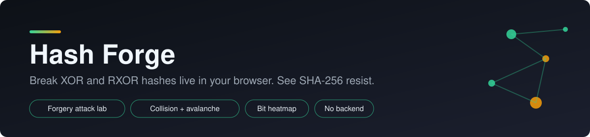
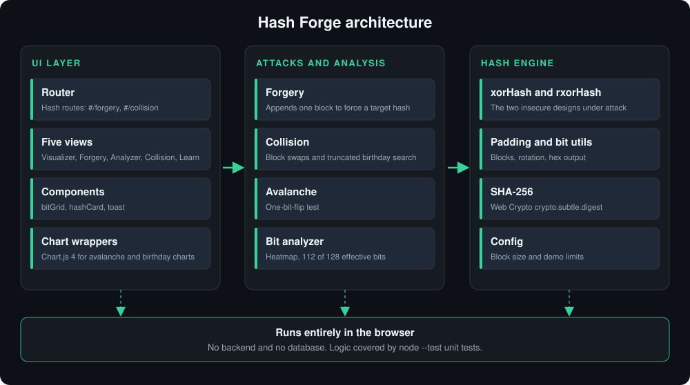

<p align="center">
  
</p>

<h1 align="center">Hash Forge</h1>

<p align="center">
  <b>Break XOR and RXOR hashes live in your browser. See SHA-256 resist.</b>
</p>

<p align="center">
  
  
  
  
  
</p>

> We don't just tell you XOR and RXOR hashes are insecure. We break them live, and show a real hash (SHA-256) resisting the same attacks.

Hash Forge is a browser-based lab that turns the theory of simple hash functions (XOR, rotated XOR and their security limits) into something you can see, click and break. It runs **entirely in the browser**: no backend, no database.

## Architecture

<p align="center">
  
</p>

See [docs/architecture.md](docs/architecture.md) for the layers and data flow.

## Features

| # | Module | What it does |
|---|--------|--------------|
| 1 | **Hash Visualizer** | Step-by-step animation: text → ASCII → binary → padding → blocks → XOR or RXOR → hash, with an XOR vs RXOR side-by-side mode |
| 2 | **Forgery Attack Lab** | Type a malicious message and the app computes the one extra block that gives it the same hash as the original. A SHA-256 comparison shows the same attack failing |
| 3 | **Predictable-Data Analyzer** | Bit-position heatmap for any text or file, highlights the always-zero high bit, and computes effective hash bits (112 of 128) |
| 4 | **Collision and Avalanche Lab** | Instant XOR and RXOR collisions, a truncated-SHA-256 birthday search, and a one-bit-flip avalanche test with charts |
| 5 | **Learn Panel** | Short explainer cards and a comparison table that mirror the presentation |

**Extras:** dark and light themes, keyboard and screen-reader support, reduced-motion support, projector-friendly scaling, and shareable links for every page (`#/forgery`, `#/collision`, ...).

## Screenshots

<!-- Replace with real screenshots: Visualizer, Forgery Lab, Analyzer heatmap, Collision and Avalanche charts -->
| Visualizer | Forgery Lab |
|---|---|
| _add screenshot_ | _add screenshot_ |
| **Analyzer heatmap** | **Collision and Avalanche** |
| _add screenshot_ | _add screenshot_ |

## Tech stack

- HTML5, CSS3, vanilla JavaScript (ES modules), no framework
- Web Crypto API (`crypto.subtle.digest`) for SHA-256
- Chart.js 4 (loaded from a CDN)
- Node's built-in test runner (`node --test`) for the hash logic

## Setup and run

ES modules need `http(s)`, so the page cannot be opened by double-clicking `index.html` (`file://` will not work).

```bash
# 1. get the project
git clone https://github.com/NartanNaik/HashForge.git
cd HashForge

# 2. serve it locally, either:
npx serve .
# or open the folder in VS Code and use the "Live Server" extension
```

Then open the printed `http://localhost:...` address. SHA-256 needs a secure context, which means https or `http://localhost`. A plain `http://192.168.x.x` address will show a warning and SHA-256 will not work.

## Run the tests

Requires Node 18 or newer. `package.json` must contain `"type": "module"`.

```bash
npm test
```

This runs `node --test tests/` over the tests for `xorHash`, `rxorHash`, `forgery`, `collision` and `bitAnalyzer`.

## Deploy (free)

**GitHub Pages:** push the project, then *Settings → Pages* and deploy from the `main` branch, root folder. The link will be `https://<user>.github.io/<repo>/`.

**Netlify:** drag the project folder onto the Netlify dashboard, or connect the repository. No build step is needed.

Both give you https, so SHA-256 works.

## How the attacks work

Let **T** be the target hash (the hash of the original message) and **n** the block size.

### XOR hash: `h = B1 ^ B2 ^ ... ^ Bm`

- **Forgery.** Zero-pad the forged message and let `S` be the XOR of its blocks. Append `X = S ^ T`. The new hash is `S ^ X = T`.
- **Collision.** XOR is commutative, so swapping two different blocks gives a different message with the same hash.
- **Avalanche.** Flipping one input bit flips exactly one output bit.
- **Predictable data.** ASCII bytes have bit 7 equal to 0. With a 128-bit hash (16 bytes) those 16 bits stay 0, leaving 112 effective bits (2^-112 instead of 2^-128).

### RXOR hash: `h = 0; for each block Bi: h = ROL1(h) ^ Bi`

- **Forgery.** Process the padded forged message to get `h'` and append `X = ROL1(h') ^ T`. The next step gives `ROL1(h') ^ X = T`.
- **Collision.** Swapping blocks no longer works (order matters), but the forgery construction still forces any message to any target hash.
- **Avalanche.** Still exactly one output bit changes: the rotation only moves it.

### SHA-256

SHA-256 resists all of this: one flipped input bit changes about half of the 256 output bits, and finding a collision needs about 2^128 work. The birthday demo shows the growth on truncated hashes (8 to 32 bits).

> **Honest limitation.** The appended forgery block is essentially arbitrary bytes, so it may show as unreadable characters. The app displays it in hex. In a real attack it could be hidden, for example in a comment field.

## Project structure

```
HashForge/
├── index.html            # page shell
├── css/                  # base, layout, components, animations
├── js/
│   ├── main.js           # entry point: theme, safety net, router start
│   ├── core/             # hash engine: bitUtils, padding, xorHash, rxorHash, sha256, config
│   ├── attacks/          # forgery, collision, avalanche
│   ├── analysis/         # bitAnalyzer
│   ├── ui/               # router, five views, components (bitGrid, hashCard, toast)
│   └── charts/           # Chart.js wrappers
├── assets/
│   ├── banner.svg
│   ├── architecture.svg
│   └── sample-files/     # english.txt, random.bin.txt, contract.txt
├── tests/                # node --test unit tests
└── docs/                 # architecture.md, demo-script.md, viva-qna.md
```

## Documentation

- [Architecture](docs/architecture.md): layers and data flow
- [Demo script](docs/demo-script.md): live demo plan
- [Viva Q&A](docs/viva-qna.md): likely viva questions

## Disclaimer

XOR and RXOR hashes are taught here as examples of **insecure** designs. Never use them for real security. Use SHA-256 or SHA-3, and HMAC or digital signatures when an attacker can change both the message and the hash.

## License

Add a license of your choice (for example MIT) before publishing.
